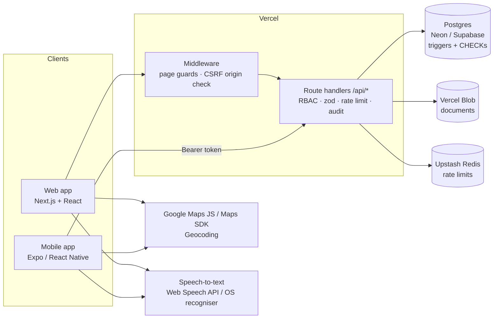

# 1. System Architecture & Tech Stack

## Overview

## Stack and rationale

| Concern | Choice | Why |
|---|---|---|
| Web + API | **Next.js 15 (App Router)** on Vercel | One deployable for UI and backend; route handlers become serverless functions; shared TypeScript types |
| Mobile | **Expo (React Native) + expo-router** | One codebase for iOS/Android; native maps, secure storage, speech recognition |
| Shared contracts | `packages/shared` (**zod**) | Same validation in browser, server and mobile reference; status state-machine defined once |
| Database | **PostgreSQL** (Neon, Supabase or Vercel Postgres) + **Prisma** | Relational integrity, **triggers/CHECKs** for the evaluation lock, array columns for skills |
| Auth | Own JWT: 15-min access token + rotating 30-day refresh token (SHA-256 hashed in DB) | Web: httpOnly cookies. Mobile: Bearer tokens in SecureStore. Refresh-reuse detection revokes the session family |
| Passwords | bcrypt, 12 rounds, lockout after 5 failures | |
| RBAC | `STUDENT` / `COMPANY` role in the token; resource ownership re-checked on every request (`lib/access.ts`) | Token claims are never trusted for ownership |
| Maps | **Google Maps** — `@vis.gl/react-google-maps` (web), `react-native-maps` with Google provider (mobile); Geocoding for manual place search | Proximity filtering is done server-side (Haversine in parameterised SQL) |
| Talk-to-text | Web: **Web Speech API** (`useSpeechToText`). Mobile: `expo-speech-recognition` | Zero server cost; live interim text; editable before send. Chrome sends audio to Google — disclose it, or move to server-side Whisper later |
| Realtime chat | Short polling (3 s) | Vercel functions cannot hold sockets. Replace with Ably / Pusher / Supabase Realtime without changing the REST contract |
| Files | Vercel Blob | Simple; 4 MB request limit on Vercel functions (use client uploads for bigger files) |
| Rate limiting | Upstash Redis sliding window | Needed on serverless; in-memory fallback only for dev |
| 3D hero | `three` + `@react-three/fiber`, lazy-loaded | ~1k points + 4 arcs, no textures; loads after idle; paused off-screen; static fallback |

## Request lifecycle (protected API call)

1. Middleware: for cookie-authenticated mutations, reject cross-origin (`Origin`/`Sec-Fetch-Site`).
2. `route()` wrapper → `requireSession` / `requireRole` (verifies JWT signature, issuer, audience, expiry).
3. `readJson(req, schema)` — size cap + strict zod parse (unknown keys rejected).
4. `rateLimit(...)` where relevant.
5. Resource check (`loadParticipantApplication`) → **404** when caller is not a participant.
6. Transaction: business write + `audit()` row commit atomically.
7. Database triggers/CHECKs are the last line of defence.

## Mobile ↔ backend boundary

- One backend: the deployed Vercel URL. `EXPO_PUBLIC_API_URL` selects it (LAN IP locally, `https://…vercel.app` or custom domain in production).
- Mobile sends `x-client: mobile`; server returns tokens in JSON (no cookies) and the app stores them in the OS keychain.
- Native apps are not subject to browser CORS, so no CORS config is required. If you later add a separate web origin, add explicit CORS for that origin only.
- Same DB, same users: an account created on web signs in on mobile.
