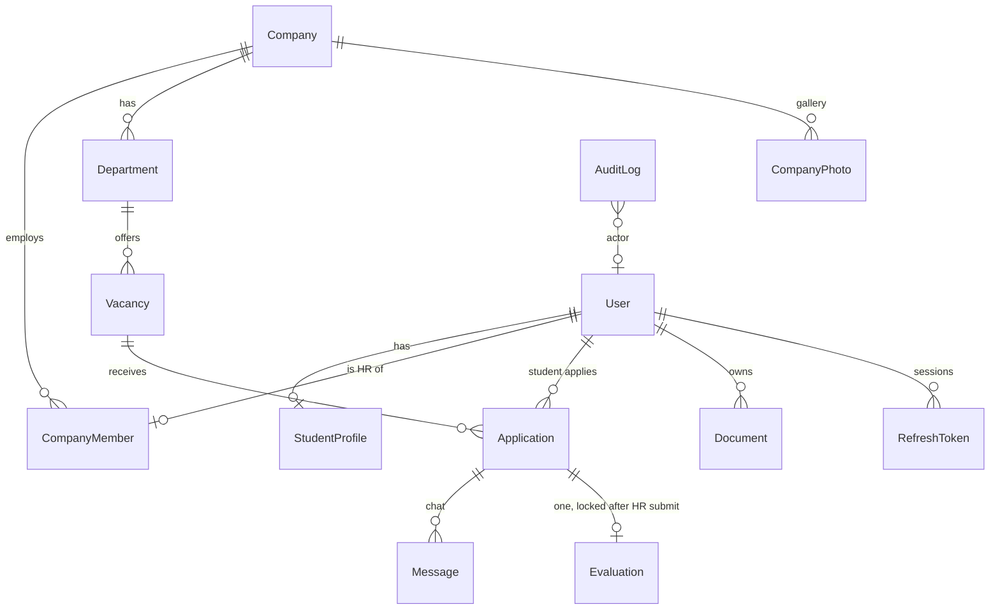

# 2. Database Schema & Security / Locking Rules

Source of truth: `apps/web/prisma/schema.prisma` + `prisma/migrations/0002_integrity_locks/migration.sql`.

## Entity overview



| Table | Key points |
|---|---|
| `User` | `role` STUDENT/COMPANY, bcrypt hash, `failedLogins`/`lockedUntil` |
| `StudentProfile` | institution, program, level, skills[], bio, portfolio, home & vacation lat/lng |
| `Company` | overview, industry, culture, address, **digitalAddress**, phone, lat/lng, linkedin/twitter/instagram/facebook/website |
| `Department` | **`totalSlots`** (exact slots), `requiredSkills[]` |
| `Vacancy` | `slots`, `slotsFilled`, `requiredSkills[]`, **`applicantRequirements` JSON** (program, level, institution, portfolio, availability, cv, studentId, coverNote), dates. CHECK `slotsFilled <= slots` |
| `Application` | unique(vacancy, student); status machine in `@internlink/shared`; intro-letter / CV / ID document ids |
| `Message` | per application; `deliveredAt`, `readAt` |
| `Evaluation` | 1:1 with application; **immutable once `SUBMITTED`** |
| `AuditLog` | append-only (DB trigger) |

## RBAC matrix

| Action | Student | Company (HR) | Enforcement |
|---|---|---|---|
| Register / sign in | ✔ | ✔ | zod, rate limit, lockout |
| Edit company profile, departments, vacancies | ✘ 403 | ✔ own company only | `requireRole('COMPANY')`; `companyId` from token; dept ownership checked |
| Search vacancies | ✔ | ✔ | parameterised SQL |
| Apply | ✔ | ✘ | `requireRole('STUDENT')`; docs must be caller's own |
| Change application status | withdraw only | review/shortlist/accept/reject/complete | `STATUS_TRANSITIONS[from][role]`; atomic slot claim |
| Read/write chat | participant only | participant only | `loadParticipantApplication` → 404 otherwise |
| Request evaluation | ✔ once, only when `COMPLETED` | ✘ | route + unique(applicationId) |
| **Submit evaluation** | ✘ always | ✔ once | route + conditional UPDATE + DB trigger |
| **Edit/delete submitted evaluation** | ✘ | ✘ | **No endpoint exists**; DB trigger rejects everyone |
| Download a document | owner / own evaluation's HR copy | docs attached to its applications | `canReadDocument` → 404 |

## The locked post-attachment evaluation — four layers

State machine: `(none) → REQUESTED → SUBMITTED (terminal)`.

1. **UI (honest reflection).** For a `SUBMITTED` evaluation `EvaluationPanel` renders no input, textarea or button for either role — only the scores, remarks, submitter, timestamp, integrity badge and seal hash. A student in `REQUESTED` state only sees "Awaiting HR".
2. **API role + shape checks.** `PATCH /api/evaluations/:applicationId`
   - Student branch accepts only `{ formDocId }` via a `.strict()` schema — sending `scores`, `remarks`, `status`, `submittedAt` … is a **400**, not silently ignored.
   - Company branch accepts `evaluationSubmitSchema` (all five scores, remarks ≥ 10 chars, recommend, explicit `confirm: true`).
   - There is **no PUT/DELETE handler** for evaluations (405).
   - Non-participants get 404.
3. **Status-conditional write.** Both branches use `updateMany({ where: { applicationId, status: 'REQUESTED' } })`. Once `SUBMITTED`, 0 rows match → **409 `EVALUATION_LOCKED`**. This also makes double-submits and races harmless.
4. **Database trigger (survives app bugs).** `evaluation_lock_guard` (BEFORE UPDATE OR DELETE):
   - any UPDATE/DELETE where `OLD.status = 'SUBMITTED'` → exception (`EVALUATION_LOCKED`);
   - provenance columns (`applicationId`, `requestedById`, `requestedAt`) can never change;
   - a transition to `SUBMITTED` must carry scores, remarks, submitter, timestamp and hash;
   - `TRUNCATE` blocked by statement trigger;
   - CHECK `Evaluation_state_shape_chk` (REQUESTED rows are empty; SUBMITTED rows are complete);
   - CHECK: submitter ≠ requester (a student can never submit their own evaluation).

**Submission metadata & tamper evidence.** On submit the server stores `submittedById`, `submittedAt` and `contentHash = SHA-256(canonical[applicationId, submitter, timestamp, scores, remarks, recommend, responseDocId])`. `GET` recomputes the hash and returns `integrity: ok | mismatch`, so even a privileged out-of-band DB edit is detectable. The `audit_log` records `evaluation.request`, `evaluation.replace_form`, `evaluation.submit` (with hash) in the same transaction.

**Test it** (after seeding; replace tokens/ids):
```bash
# student tries to tamper after HR submitted → 400 (unknown keys) or 409 (locked)
curl -X PATCH $URL/api/evaluations/$APP_ID -H "Authorization: Bearer $STUDENT" -H 'x-client: mobile' \
  -H 'content-type: application/json' -d '{"scores":{"punctuality":5,"technical":5,"communication":5,"teamwork":5,"initiative":5}}'
# HR submits twice → second call 409 EVALUATION_LOCKED
# Direct SQL (proves the DB itself refuses):
psql $DIRECT_URL -c "UPDATE \"Evaluation\" SET remarks='x' WHERE status='SUBMITTED';"   # ERROR: EVALUATION_LOCKED
```

> **Honest limit:** a database superuser/table owner can `ALTER TABLE … DISABLE TRIGGER`. Run the app with a non-owner role and keep the owner credentials (used only for migrations — `DIRECT_URL`) out of the runtime environment where possible. The integrity hash is there to detect that kind of tampering.

## Security controls checklist

| Area | Control (where) |
|---|---|
| Passwords | bcrypt-12; constant-time-ish compare for unknown emails; lockout 5 fails/15 min (`api/auth/login`) |
| Tokens | 15-min JWT (HS256, issuer + audience checked); refresh tokens random, hashed, rotated, reuse ⇒ revoke all (`lib/auth.ts`) |
| Cookies | `httpOnly`, `Secure` (prod), `SameSite=Lax`; refresh cookie path-scoped to `/api/auth` |
| CSRF | Origin / `Sec-Fetch-Site` check on cookie-authenticated mutations (`middleware.ts`); mobile uses Bearer |
| Validation | zod `.strict()` schemas on every body; control-char stripping; https-only URLs; JSON body ≤ 100 KB |
| SQL injection | Prisma + `Prisma.sql` bound parameters (also for `ILIKE`, `LIKE` escaped, array filters) |
| XSS | React escaping; no `dangerouslySetInnerHTML`; CSP (starts in report-only — see deployment doc) |
| Uploads | role→kind allowlist, extension allowlist, **magic-byte sniffing**, 4 MB cap, random storage names, owner-checked references |
| Rate limits | register 10/h/IP · login 20/10 min/IP + 8/15 min/email · apply 20/h · upload 20/h · chat send 30/min · chat poll 120/min |
| Authorisation | ownership re-checked per request; 404 instead of 403 for foreign resources |
| Audit | `AuditLog` append-only trigger; written in the same transaction as the change |
| Secrets | env vars only; `.env*` git-ignored; `.env.example` has placeholders |
| Headers | HSTS, nosniff, frame deny, referrer policy, permissions policy (geolocation/microphone self only) |

## Supabase users (optional hardening)
Prisma connects as a privileged role, bypassing RLS. If you also expose tables via Supabase's PostgREST, enable RLS on all tables with **no** permissive policies (deny-all) so only the server can touch data:
```sql
DO $$ DECLARE t text; BEGIN
  FOR t IN SELECT tablename FROM pg_tables WHERE schemaname='public' LOOP
    EXECUTE format('ALTER TABLE %I ENABLE ROW LEVEL SECURITY', t);
  END LOOP; END $$;
```
